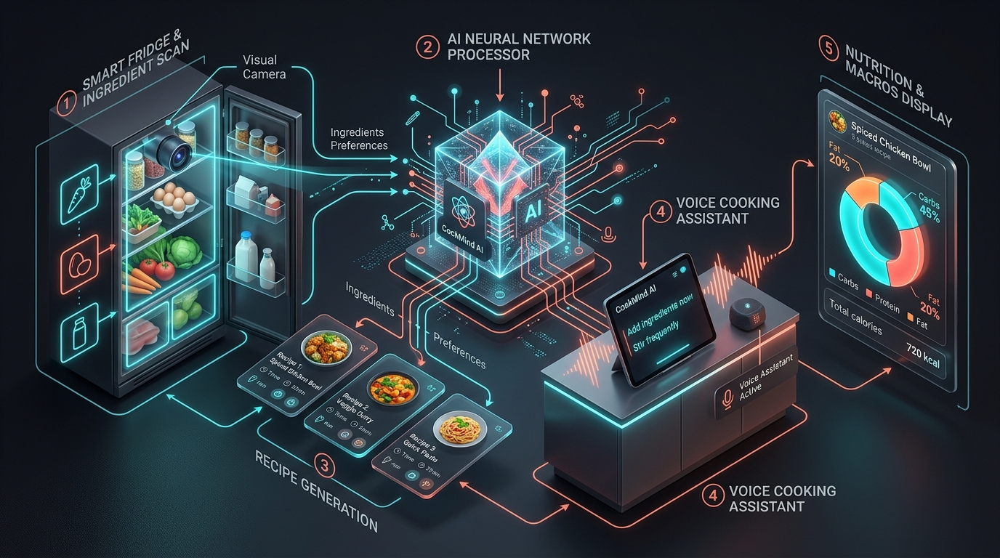
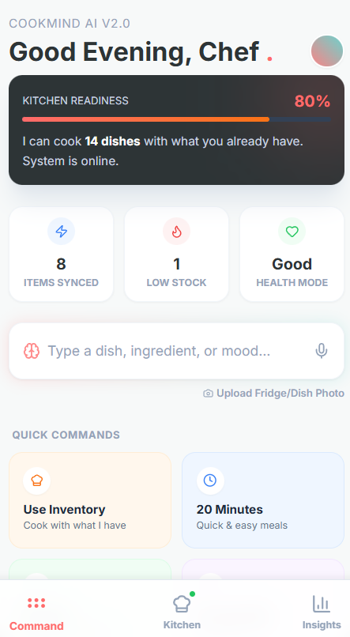
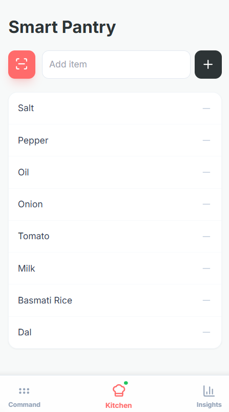
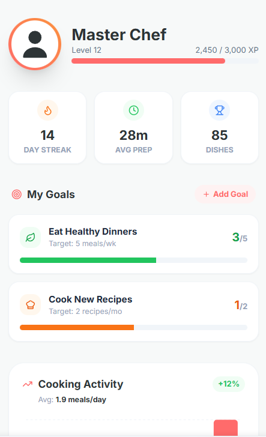
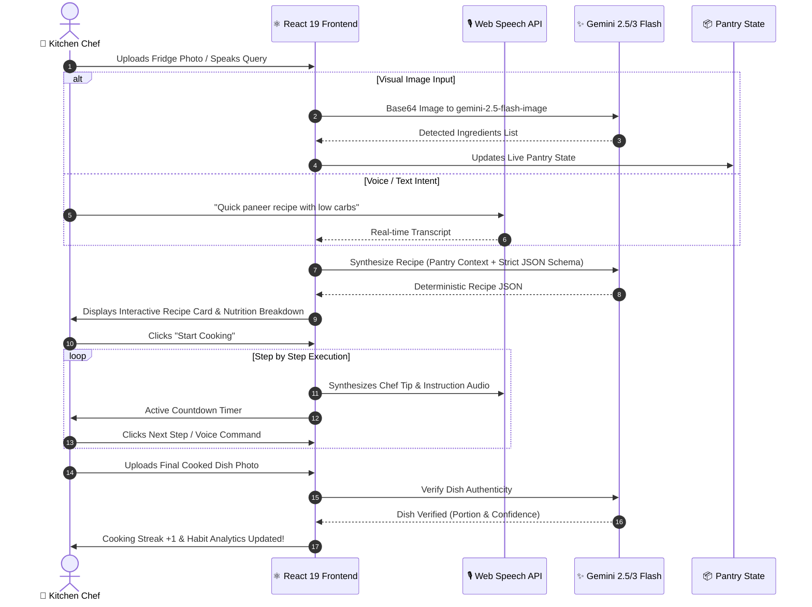

<div align="center">


# 🍳 CookMind AI
### The Autonomous Multimodal Kitchen Intelligence Operating System

[](https://aistudio.google.com/)
[](https://react.dev/)
[](https://www.typescriptlang.org/)
[](https://vitejs.dev/)
[](https://tailwindcss.com/)
[](LICENSE)
[](docs/CONTRIBUTING.md)

<p align="center">
  <b>Transform your fridge photo, voice, or random cravings into precision recipes, real-time nutrition analytics, and hands-free guided cooking.</b><br>
  <i>Zero hallucinations. Zero food waste. True multimodal kitchen intelligence.</i>
</p>

[✨ Try on AI Studio](https://ai.studio/apps/drive/1hw9osyC1sUhh22tWvQubYFqjW1DgxHQh) • 
[📖 Architecture](docs/ARCHITECTURE.md) • 
[🔌 API Guide](docs/API_GUIDE.md) • 
[🤝 Contributing](docs/CONTRIBUTING.md) • 
[🐛 Report Bug](https://github.com/EnternalBlue07/CookMind-AI/issues)

</div>

---

## 🌟 Why CookMind AI?

Traditional recipe apps are broken: they assume you have rare spices, ask you to manually type 30 ingredients, and hallucinate steps without regard for what is actually in your fridge.

**CookMind AI** solves this through **Visual & Sensory Intelligence**:
- 👁️ **Visual Fridge & Pantry Perception**: Snap a photo of your fridge or countertop — Gemini 2.5 Flash extracts all available items into your live kitchen database.
- 🚫 **Zero-Hallucination Recipe Synthesis**: Suggests dishes based strictly on what you have, prioritizing pantry staples and minimizing food waste.
- 🎙️ **Hands-Free Kitchen Voice Guidance**: Built with native Web Speech Recognition & Speech Synthesis for safe, messy-hands cooking guidance.
- 💰 **INR Cost Estimation & Regional Styles**: Instant approximate cost breakdown in Indian Rupees (₹) with regional cuisine adaptations (Dhaba style, South Indian, Mediterranean, etc.).
- 🥗 **Dynamic Macro Nutritional Breakdown**: Interactive Recharts graphs detailing calories, protein, carbs, and fats.
- ✅ **Proof-of-Cooking Verification**: Upload a photo of the finished dish to verify completion, update your cooking streak, and train your personal taste profile.

---

## 🖼️ Visual Showcase

<div align="center">

### ⚡ The Multimodal System Architecture


<br/>

### 📱 Product Experience Gallery

| 📋 AI Recipe & Nutrition Analysis | 🍳 Hands-Free Step Cooking Mode | 📊 Habit & Nutrition Insights |
| :---: | :---: | :---: |
|  |  |  |
| *Visual ingredient breakdown, smart substitutes, and INR costing* | *Step countdown timers, chef tips, and text-to-speech audio* | *Flavor radar, weekly meals tracker, and cooking streaks* |

</div>

---

## 🏗️ System Flow & Engineering

CookMind AI operates on a **Multimodal Inference Loop** utilizing Google's `@google/genai` SDK:



---

## ⚡ Key Features

| Feature | Description | Tech Highlight |
| :--- | :--- | :--- |
| **📸 Visual Fridge Scanner** | Takes an image of open fridge/shelves and extracts visible ingredients into pantry state. | `gemini-2.5-flash-image` |
| **🧠 Zero-Waste Recipe Engine** | Prioritizes using on-hand ingredients, flags missing items, and calculates substitutes. | `gemini-3-flash-preview` |
| **🎙️ Voice Command & Audio Coach** | Voice-dictate recipe requests and listen to step-by-step guidance hands-free. | Web Speech API |
| **🥗 Nutritional Profiling** | Instant calorie and macro charts (Protein, Carbs, Fats) with health badges. | Recharts + Type Schema |
| **💰 INR Budget Estimator** | Itemized cost estimation per ingredient and total recipe budget in Indian Rupees. | Deterministic Prompting |
| **⏱️ Active Step Timers** | Built-in smart timers per cooking step with audio alert cues. | React Custom Hooks |
| **🛒 Smart Grocery List** | Move missing recipe ingredients straight into an editable shopping list. | Local State Persistence |
| **🏆 Proof-of-Cooking Verification** | Requires a photo of the completed dish before logging session to prevent fake streaks. | Computer Vision Verification |

---

## 🛠️ Technology Stack

- **Core Framework**: [React 19](https://react.dev/) + [TypeScript](https://www.typescriptlang.org/)
- **Bundler & Dev Server**: [Vite 6](https://vitejs.dev/)
- **AI Engine**: Google GenAI SDK (`@google/genai`)
  - `gemini-2.5-flash-image` (Visual pantry perception & proof verification)
  - `gemini-3-flash-preview` (Ultra-fast structured recipe synthesis)
- **Styling & UI**: [TailwindCSS](https://tailwindcss.com/) with Appetizing Sunset & Fresh Mint custom palettes
- **Data Visualization**: [Recharts](https://recharts.org/) (Bar charts, Radar charts, Pie distributions)
- **Iconography**: [Lucide React](https://lucide.dev/)
- **Audio APIs**: Native Browser `SpeechRecognition` & `SpeechSynthesis`

---

## 🚀 Getting Started

### Prerequisites
- **Node.js**: v18.0.0 or higher
- **npm** or **pnpm**
- **Google Gemini API Key** (Get yours free from [Google AI Studio](https://aistudio.google.com/app/apikey))

### 1. Clone the Repository
```bash
git clone https://github.com/EnternalBlue07/CookMind-AI.git
cd CookMind-AI
```

### 2. Install Dependencies
```bash
npm install
```

### 3. Configure Your API Key
Create a `.env.local` file in the project root:
```env
GEMINI_API_KEY=your_google_gemini_api_key_here
```

### 4. Run Locally
```bash
npm run dev
```
Navigate to `http://localhost:3000` in your browser.

### 5. Build for Production
```bash
npm run build
npm run preview
```

---

## 📂 Project Structure

```bash
CookMind-AI/
├── 📁 components/
│   ├── CookingMode.tsx          # Fullscreen interactive step-by-step cooking & timer
│   ├── InsightsDashboard.tsx    # Food habit analytics, flavor radar & cooking streaks
│   └── NutritionChart.tsx       # Recharts macro-nutrient breakdown visualization
├── 📁 docs/
│   ├── 📁 images/               # High-res banners, diagrams & app screenshots
│   │   ├── cookmind-hero-banner.png
│   │   ├── cookmind-workflow-architecture.png
│   │   ├── cookmind-recipe-analysis.png
│   │   ├── cookmind-cooking-mode.png
│   │   └── cookmind-insights-dashboard.png
│   ├── API_GUIDE.md             # Gemini API schemas and integration specs
│   ├── ARCHITECTURE.md          # Deep-dive system engineering blueprint
│   └── CONTRIBUTING.md          # PR standards and local development guide
├── 📁 services/
│   └── geminiService.ts         # Multimodal Gemini API calls & JSON schemas
├── App.tsx                      # Main application state, views & navigation
├── types.ts                     # TypeScript data interfaces & enums
├── vite.config.ts               # Vite configuration with env aliases
├── package.json                 # Project dependencies & scripts
└── README.md                    # Project documentation & visual showcase
```

---

## 🗺️ Product Roadmap

- [x] **v1.0**: Multimodal recipe generation via text, voice, and fridge photography.
- [x] **v1.1**: Step-by-step cooking mode with voice audio coach and step timers.
- [x] **v1.2**: Nutritional macro visualization, shopping list sync, and INR cost tracking.
- [ ] **v1.3**: Multilingual audio guidance (full audio Hindi and Hinglish voice packs).
- [ ] **v1.4**: Barcode & grocery receipt scanning integration.
- [ ] **v1.5**: IoT kitchen integration (smart oven & induction cooktop timers).

---

## 🤝 Contributing

Contributions make the open-source community thrive!
1. Fork the Project
2. Create your Feature Branch (`git checkout -b feat/AmazingFeature`)
3. Commit your Changes (`git commit -m 'feat: Add AmazingFeature'`)
4. Push to the Branch (`git push origin feat/AmazingFeature`)
5. Open a Pull Request

Please refer to the [Contributing Guide](docs/CONTRIBUTING.md) for details.

---

## 📄 License

Distributed under the **MIT License**. See [`LICENSE`](LICENSE) for more information.

---

## 👨‍💻 Author

**Zumaan Sayyed** ([@EnternalBlue07](https://github.com/EnternalBlue07))

<div align="center">
  <sub>Built with ❤️ and passion for culinary intelligence and zero food waste.</sub>
</div>
