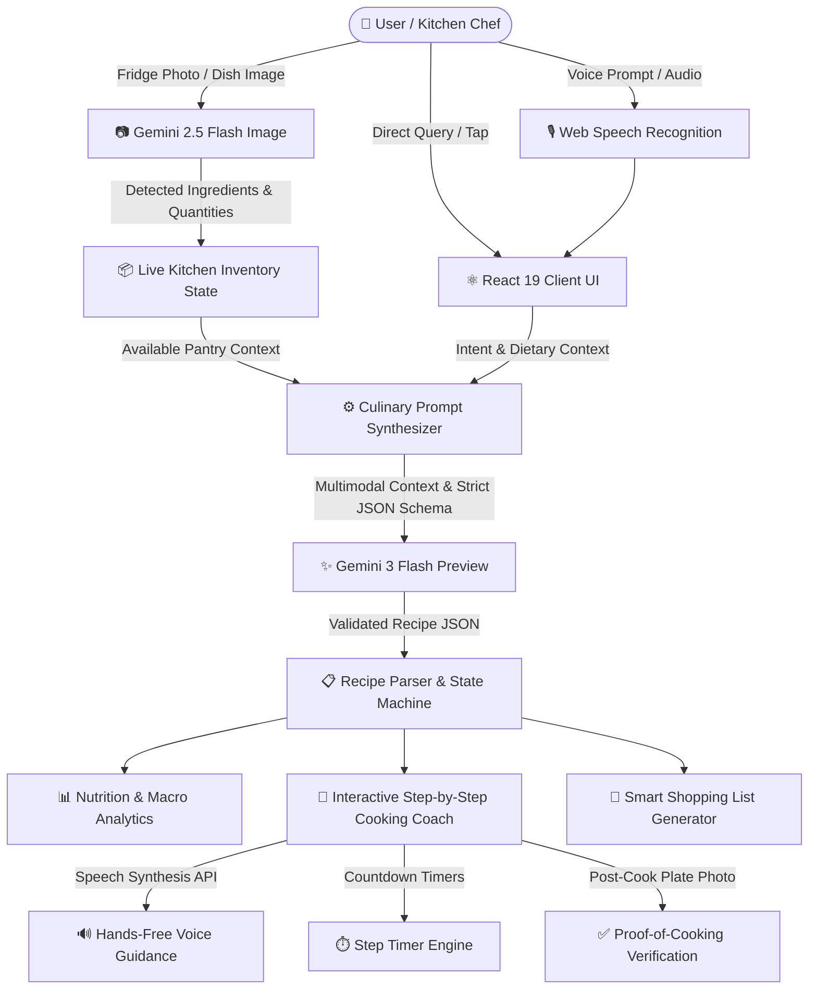
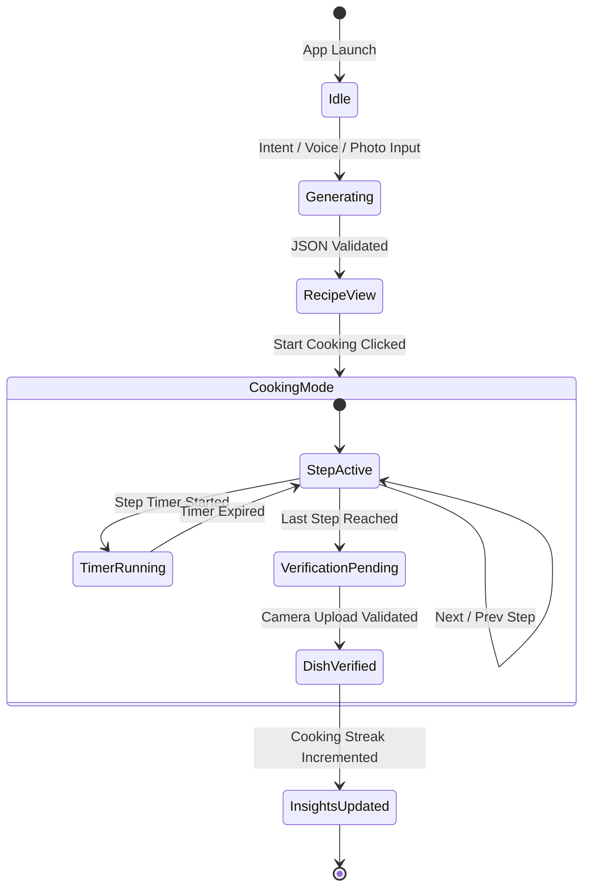

# 🧠 CookMind AI — System Architecture & Engineering Blueprint

This document details the architectural principles, multimodal pipelines, data schemas, and design decisions behind **CookMind AI** — an autonomous kitchen intelligence system designed for zero-hallucination recipe synthesis, real-time inventory synchronization, and hands-free cooking guidance.

---

## 🏛️ High-Level System Architecture

CookMind AI adopts a decoupled, client-centric reactive architecture powered by Google's latest Gemini models. The system converts raw sensory inputs (fridge photography, vocal intent, manual text) into validated, structured culinary execution plans.



---

## 🔬 Core Architectural Subsystems

### 1. Multimodal Vision Pipeline (`gemini-2.5-flash-image`)
The visual intelligence subsystem is optimized for low-latency food identification without requiring cloud storage for sensitive kitchen imagery:
- **Client-Side Image Encoding**: Raw camera/gallery files are read via HTML5 `FileReader` and serialized into Base64 JPEG payloads.
- **Strict Ingredient Detection**: The prompt constrains the model to only report items visually identifiable on shelves, in refrigerators, or on countertops.
- **Zero Hallucination Constraint**: Unlike traditional LLM recipe generators that invent obscure ingredients, CookMind AI prioritizes strict inventory matching.

### 2. Structured Recipe Synthesis (`gemini-3-flash-preview`)
Recipe generation uses Google GenAI SDK (`@google/genai`) configured with strict `responseSchema` (JSON Schema standard):
- **Deterministic Schema**: Guarantees typed fields for dish name, preparation time, cooking time, difficulty level, INR cost estimate, regional style, nutritional breakdown, ingredient list, and step-by-step instructions.
- **Fuzzy Inventory Cross-Referencing**: Each ingredient includes an `inInventory` boolean flag, computed both during model inference and verified client-side via normalized fuzzy string matching.

### 3. Hands-Free Voice Guidance Engine
Cooking requires clean hands. CookMind AI leverages native browser APIs:
- **Web Speech Recognition (`SpeechRecognition` / `webkitSpeechRecognition`)**: Captures real-time natural language input and queries in English, Hindi, and Hinglish.
- **Speech Synthesis (`SpeechSynthesisUtterance`)**: Speaks step instructions aloud, appending dynamic "Chef's Tips" to warn the user about heat levels, timing, and flavor balancing.

### 4. Interactive Cooking & State Machine
The cooking session follows a strict progressive state machine:


---

## 📐 Data Schemas

### 1. Recipe Schema
```typescript
interface Recipe {
  id: string;
  name: string;
  description: string;
  prepTime: string;
  cookTime: string;
  difficulty: 'Easy' | 'Medium' | 'Hard';
  servings: number;
  costEstimate: string; // e.g. "₹120 - ₹180"
  regionalStyle?: string; // e.g. "North Indian / Dhaba Style"
  ingredients: Ingredient[];
  steps: CookingStep[];
  nutrition: NutritionData;
}
```

### 2. Ingredient Schema
```typescript
interface Ingredient {
  name: string;
  quantity: string;
  isMandatory: boolean;
  substitute?: string;
  inInventory?: boolean;
  estimatedCost?: string; // e.g. "₹25"
}
```

### 3. Nutrition Data Schema
```typescript
interface NutritionData {
  calories: number;
  protein: string;
  carbs: string;
  fats: string;
  healthLabel: string; // e.g. "High Protein", "Low Carb"
}
```

---

## 🛡️ Security, Privacy & Performance

1. **Zero Server Logging of User Imagery**: Images uploaded for fridge scanning or dish validation are processed directly in-memory and dispatched to Google Gemini API over TLS.
2. **Environment Isolation**: API keys are isolated via Vite `define` bindings using `GEMINI_API_KEY` and never hardcoded in git version control.
3. **Optimized Bundle Footprint**: Uses tree-shaken Lucide icons, Vite 6 build optimizer, and lightweight Recharts modules.
